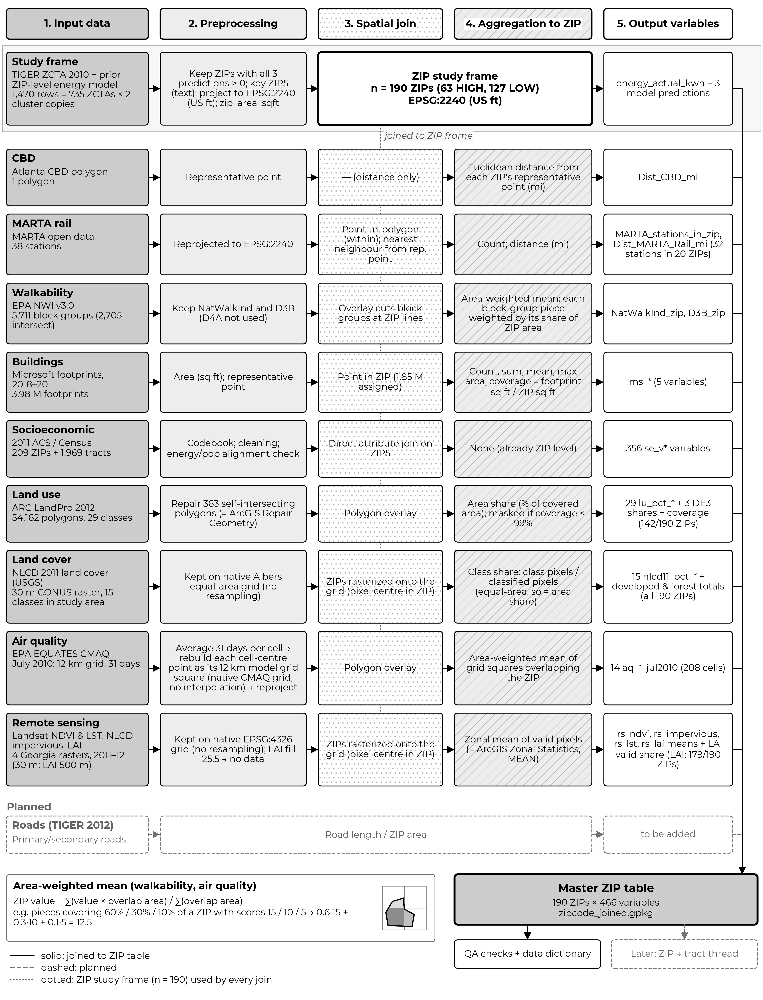
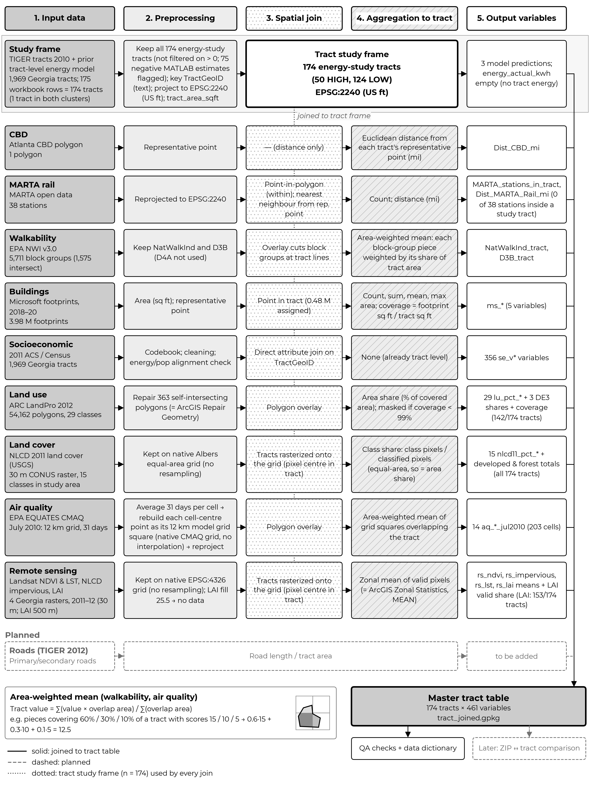

# Atlanta Metro Energy & Urban Morphology

A research data pipeline for the Atlanta Metro Region. It combines residential energy use with urban
form, transit access, walkability, building footprints and socioeconomic variables, and it tests
whether a prior ZIP-level energy model (Random Forest and MATLAB regression) stays spatially
consistent when aggregated from ZIP Code to Census Tract level.

## Status

- **ZIP-level data preparation: done.** [`notebooks/01_data_preparation.ipynb`](notebooks/01_data_preparation.ipynb)
  builds the 190-ZIP master table. Each data source has its own section with its method, EDA,
  sanity checks and maps:
  - distance to the CBD
  - MARTA rail access
  - EPA walkability
  - Microsoft building footprints
  - 2011 ACS/Census socioeconomic variables
  - ARC LandPro 2012 land use
  - EPA EQUATES CMAQ air quality (July 2010)
  - remote-sensing rasters (NDVI, impervious surface, land surface temperature, leaf area index):
    zonal mean per ZIP
  - NLCD 2011 land cover: class shares per ZIP, complete for all 190 ZIPs (fills the LandPro gaps)
- **Tract-level data preparation: done.** [`notebooks/02_tract_preparation.ipynb`](notebooks/02_tract_preparation.ipynb)
  builds the 174-tract master table with the same sections, sources and aggregation methods as
  notebook 01, so the two tables are directly comparable.
- **Pending:** road density (TIGER 2012 primary and secondary roads) and the ZIP ↔ tract
  cross-scale comparison of the energy model.

## Workflow

ZIP level:



Census-tract level:



Vector versions for print: [`figures/workflow_paper.pdf`](figures/workflow_paper.pdf) and
[`figures/workflow_tract_paper.pdf`](figures/workflow_tract_paper.pdf). Simplified 16:9 versions for
slides: [`figures/workflow_slide.png`](figures/workflow_slide.png) and
[`figures/workflow_tract_slide.png`](figures/workflow_tract_slide.png). All of them are drawn by
[`scripts/make_workflow_diagrams.py`](scripts/make_workflow_diagrams.py); run it from the repo root
(`--unit zip`, the default, or `--unit tract`) to regenerate them after adding data.

## How to reproduce

The ZIP-level master table (`data/interim/zipcode_joined.gpkg`, 190 ZIPs) and its data dictionary
(`data/processed/zipcode_data_dictionary.csv`) are committed, with a CSV and Excel copy of the table
without geometry (`data/processed/zipcode_master.csv`, `.xlsx`). The tract-level equivalents are
committed too: `data/interim/tract_joined.gpkg` (174 tracts), `data/processed/tract_data_dictionary.csv`
and `data/processed/tract_master.csv`, `.xlsx`. The other input data is not in the repository:
`data/` is otherwise gitignored, and some inputs are study data that is not redistributed. See the **"Reproducing this notebook"** cell at the top of
each notebook for:
- the environment setup (`pip install -r requirements.txt`, with pinned versions);
- the list of raw input files, their expected paths and their sources;
- the `nbconvert` command that runs the notebook end to end.

Run the notebooks in order:
1. `notebooks/01_data_preparation.ipynb` builds the ZIP master. Its socioeconomic section also writes
   `data/interim/socioeconomic_tract.csv` and `data/interim/socioeconomic_codebook.csv`.
2. `notebooks/02_tract_preparation.ipynb` builds the tract master. It reads those two files, so it
   cannot run before notebook 01.

Raw inputs added for the tract notebook (both gitignored): `data/raw/vectors/tiger_tracts_2010_georgia.gpkg`
(TIGER/Line 2010 Georgia census tracts, 1,969, exported from ArcGIS Pro, TIGER fields only) and
`data/raw/rasters/nlcd_2011_land_cover/` (NLCD 2011 land cover, 2011 edition of 2014-10-10, from
[MRLC](https://www.mrlc.gov/data)). Notebook 01's land-cover section reads the same NLCD folder.

## Tract-level notes

- **Study frame.** The 174 study tracts come from the HIGH and LOW model workbooks (50 and 125 rows).
  Tract 13089021909 appears in both, and its HIGH row is kept (83% of it lies in HIGH ZIP 30083), so
  the frame is 50 HIGH + 124 LOW. Unlike the ZIP frame, tracts are not filtered on predictions > 0.
- **No observed energy.** `energy_actual_kwh` is empty for every tract: the tract energy values in the
  source workbooks are all 0 placeholders. Observed energy exists only at ZIP level.
- **Negative MATLAB estimates.** 75 tracts (all LOW) have a negative MATLAB estimate; they are kept and
  flagged in `matlab_negative`.
- **MARTA.** None of the 38 stations falls inside a study tract, so `MARTA_stations_in_tract` is 0
  everywhere. Use `Dist_MARTA_Rail_mi` (0.57 to 69.2 mi).
- **Land surface temperature.** Zonal means use a 0.90 valid-pixel threshold for tracts (0.95 for
  ZIPs). One tract, 13067031001, has 91.6% valid pixels.
- **LandPro gaps.** 32 tracts lack full LandPro coverage (14 partial, 18 none); NLCD covers all 174.
- **Socioeconomic area and density.** `se_v353` (Area) and `se_v354` (density), like `se_v349`, are not
  consistent with the TIGER tract area in the source and look county-level. Use `tract_area_sqft` for
  area and density.
- **Column differences vs the ZIP table.** `ZIP5` becomes `TractGeoID` and every `*_zip` column becomes
  `*_tract`; TIGER tract fields replace the ZCTA-only ones; the ZIP-only raw fields have no tract
  source; `matlab_negative` is the one added column. Everything else keeps the same order.

## Repo layout

```
data/            # gitignored, except the master tables and data dictionaries
├── raw/         # inputs, never modified (vectors/, rasters/, tables/)
├── interim/     # CRS-standardised layers, base and joined ZIP and tract tables, codebook
└── processed/   # final outputs (ZIP and tract master tables, data dictionaries)
notebooks/       # 01_data_preparation.ipynb (ZIP), 02_tract_preparation.ipynb (tract)
scripts/         # make_workflow_diagrams.py (workflow figures)
figures/         # workflow diagrams (ZIP and tract), NLCD maps, bundled Montserrat fonts
docs/            # project background and ArcGIS methodology
tests/           # (placeholder)
```

## Project docs

- [`docs/atlanta_methodology_arcgis.md`](docs/atlanta_methodology_arcgis.md): the step-by-step ArcGIS
  methodology that this pipeline reproduces, including the problems encountered and how they were
  fixed.

Join keys are always text: `ZIP5` (5 characters) and `TractGeoID` (11 characters, zero-padded).
